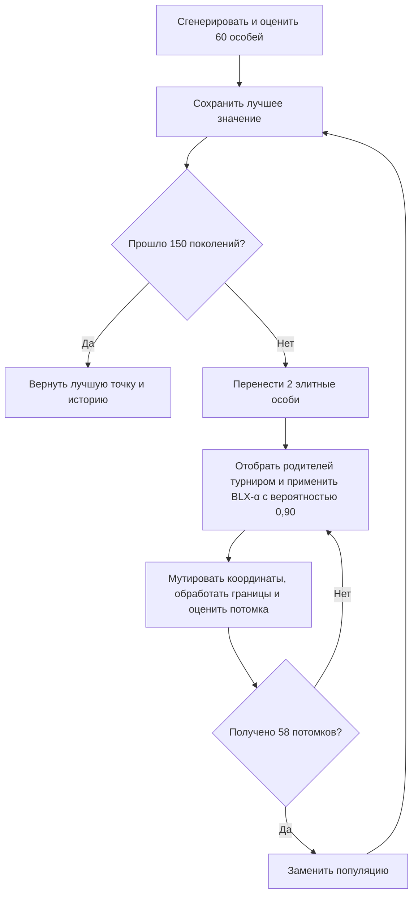
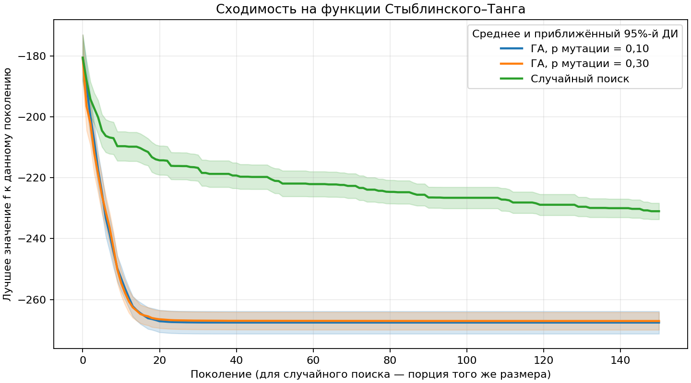

# Лабораторная работа №1. Многомерная оптимизация генетическим алгоритмом

**Группа Б24-527 · Вариант 14**

## Постановка задачи

Для номера в списке $N=9$, индекса группы $Q=2$ и года $Y=26$ получаем $V=1+((17N+7Q+Y)\bmod 20)=14$. Размерность $d=5+(14\bmod 6)=7$. Требуется минимизировать функцию Стыблинского–Танга на области $[-5,5]^7$.

$$
f(x)=\frac{1}{2}\sum_{i=1}^7 (x_i^4-16x_i^2+5x_i).
$$

Функция разделяется на семь одинаковых одномерных слагаемых $g(t)=(t^4-16t^2+5t)/2$. Внутренние стационарные точки находятся из $4t^3-32t+5=0$. Сравнение значений в трёх корнях и на концах отрезка даёт глобальный минимум при $t\approx-2{,}90353403$ и второй локальный минимум при $t\approx2{,}74680277$. Следовательно, $x^*$ имеет семь одинаковых координат $-2{,}90353403$, а $f(x^*)\approx-274{,}1631599264$.

Два локальных минимума на координату дают $2^7$ локальных минимумов всей функции. Локальный поиск может сойтись к точке с одной или несколькими координатами в правой впадине. Замена одного глобально оптимального значения координаты на правый локальный минимум увеличивает $f$ примерно на 14,14. При равномерном случайном поиске для высокой точности нужно одновременно попасть в узкую окрестность нужного значения по всем семи координатам.

## Генетический алгоритм

Генотип — вектор из семи вещественных чисел. Фенотип совпадает с генотипом, поэтому декодирование не требуется. Для отбора и сравнения используется непосредственно значение $f$. Чем оно меньше, тем лучше особь.

| Параметр | Значение |
| --- | --- |
| Начальная популяция | 60 особей, каждая координата равномерна на $[-5,5]$ |
| Селекция | Турнир из 3 различных особей, побеждает особь с минимальным $f$ |
| Кроссинговер | BLX-α с $\alpha=0{,}5$, вероятность 0,90 на потомка |
| Мутация | Независимая по координатам, добавляется нормальный шум с $\sigma=0{,}2$ |
| Вероятность мутации | 0,10 или 0,30 на каждую координату |
| Обработка ограничений | После вариации каждая координата приводится к ближайшей границе при выходе за $[-5,5]$ |
| Элитизм | 2 лучшие особи переходят в следующее поколение с уже вычисленным $f$ |
| Критерий остановки | 150 поколений после инициализации |

Турнирный отбор сравнивает значения функции без их масштабирования. При кроссинговере каждая координата потомка выбирается равномерно из $[a-\alpha(b-a),\ b+\alpha(b-a)]$, где $a$ и $b$ — меньшее и большее из значений у двух родителей. Интервал позволяет искать между родителями и немного за его пределами. Если кроссинговер пропущен, потомок наследует координаты первого родителя до мутации. Гауссовская мутация позволяет исследовать окрестность особи, а элитизм сохраняет найденное лучшее значение. BLX-α реализован самостоятельно и закрывает дополнительное задание.

## Эксперимент

Для каждой конфигурации и случайного поиска проведено по 30 независимых запусков с `seed` от 2026 до 2055. Внутри одного `seed` все три метода начинают с одних и тех же 60 случайных точек. Между конфигурациями ГА меняется только вероятность мутации. Каждый запуск делает $60+150\cdot58=8760$ вычислений $f$. Случайный поиск после начальных 60 точек генерирует 150 порций по 58 новых равномерных точек. После каждой порции сохраняется лучшее значение за всё время поиска, как и при использовании ГА с элитизмом.

| Метод | Лучшее | Среднее | Медиана | Выборочное стандартное отклонение | Худшее |
| --- | ---: | ---: | ---: | ---: | ---: | ---: |
| ГА, $p=0{,}10$ | −274,163160 | −267,566022 | −274,163156 | 10,323999 | −231,753002 |
| ГА, $p=0{,}30$ | −274,158383 | −267,074742 | −274,128506 | 8,090430 | −245,881842 |
| Случайный поиск | −246,969170 | −230,980600 | −230,325817 | 7,507757 | −220,367973 |

Для каждого поколения показано среднее лучшее значение по 30 запускам. Полоса соответствует приближённому 95%-му доверительному интервалу для среднего в этом поколении, $\bar f\pm1{,}96s/\sqrt{30}$. По оси абсцисс равные номера поколений и порций соответствуют равному числу вычислений $f$.

## Анализ результатов

Обе конфигурации ГА дали меньшее итоговое значение, чем случайный поиск, при каждом из 30 совпадающих `seed`. При $p=0{,}10$ среднее преимущество над случайным поиском составило около 36,59 единицы. Основное улучшение ГА произошло за первые 20–25 поколений. После этого средние траектории почти выровнялись.

При $p=0{,}10$ итог был ближе к теоретическому минимуму, чем при $p=0{,}30$, в 23 из 30 пар запусков. С точностью до 0,1 минимум достигался в 19 и 16 запусках соответственно. При этом у $p=0{,}30$ лучше худший результат и меньше стандартное отклонение. В этой серии меньшая вероятность мутации чаще давала высокую точность, а большая уменьшала разброс итоговых значений. Средние итоговые значения отличаются примерно на 0,49, поэтому вывод о настройках относится к проверенным параметрам и бюджету.

Лучший запуск при $p=0{,}10$ и `seed=2041` дал $f=-274{,}1631597650$ с ошибкой около $1{,}6\cdot10^{-7}$. Его координаты с округлением до шести знаков равны `(-2.903561, -2.903515, -2.903491, -2.903547, -2.903562, -2.903501, -2.903468)`. Такой результат близок к глобальному минимуму по значению функции и по всем координатам. Разрыв между лучшим и худшим запусками показывает, что точность одного запуска зависит от начальной популяции и дальнейшей эволюции.
